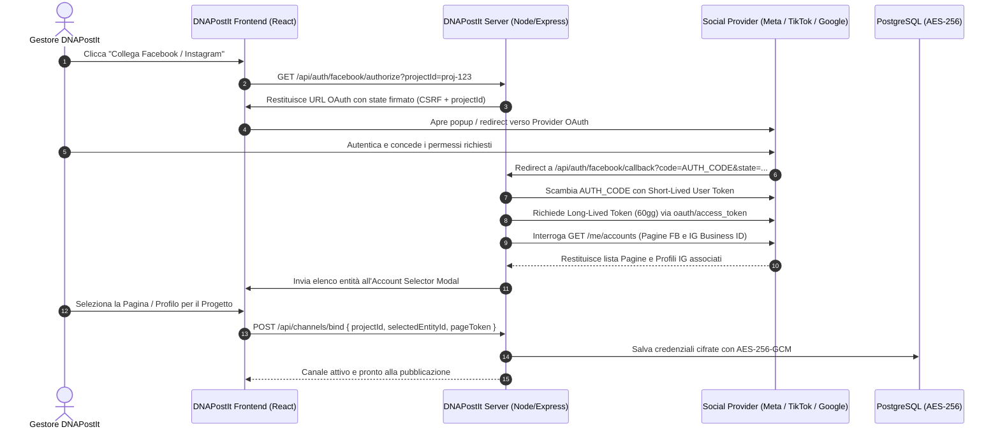

# Guida Architetturale: Integrazione Canali Social (Modello Pubblie.io)

Questa guida documenta in modo esaustivo e pronto per la produzione l'architettura tecnica per il collegamento, l'autorizzazione OAuth 2.0, la gestione dei token e la pubblicazione automatica sui 7 social network supportati da **DNAPostIt**, replicando e potenziando il modello adottato da **Pubblie.io**.

---

## 1. Panoramica del Modello Pubblie.io

In piattaforme come Pubblie.io, il collegamento dei canali social si basa su 4 pilastri fondamentali:

1. **OAuth 2.0 Multi-Tenant Delegato**: L'utente clicca su "Collega Canale", viene reindirizzato sul provider social ufficiale, concede i consensi richiesti dall'applicazione centrale registrata (App ID / Client ID) e viene reindirizzato alla callback della piattaforma.
2. **Selezione Pagina / Account (Account Discovery Modal)**:
   - Poiché un singolo account Meta può amministrare decine di Pagine Facebook e Profili Instagram aziendali, il provider restituisce la lista di tutte le entità amministrabili.
   - Viene mostrata una finestra modale in cui l'utente seleziona quale Pagina o Account associare allo specifico **Workspace / Progetto** attivo su DNAPostIt.
3. **Gerarchia dei Token e Crittografia**:
   - I token temporanei di breve durata (1-2 ore) vengono scambiati immediatamente con **Long-Lived Tokens (60 giorni)** o **Page Access Tokens permanenti**.
   - I token vengono cifrati a riposo nel database PostgreSQL con **AES-256-GCM**.
4. **Ciclo di Vita e Rinnovo Automatico (Token Lifecycle Daemon)**:
   - Un worker BullMQ monitora quotidianamente le scadenze.
   - Provider con Refresh Token (TikTok, Google, LinkedIn) vengono rinnovati in background senza intervento manuale.
   - Canali in scadenza critica generano avvisi nella campanella notifiche e nella schermata *Rinnovo Canali*.

---

## 2. Diagramma di Sequenza del Collegamento OAuth



---

## 3. Specifiche Tecniche per Ciascuno dei 7 Canali

### 3.1. Meta (Facebook Pages & Instagram Professional)
Meta unifica la gestione di Pagine Facebook e Account Instagram Business/Creator sotto la Graph API.

* **Developer Portal**: [Meta for Developers](https://developers.facebook.com/)
* **Tipo di App**: `Business`
* **OAuth Endpoint**: `https://www.facebook.com/v21.0/dialog/oauth`
* **Token Exchange Endpoint**: `https://graph.facebook.com/v21.0/oauth/access_token`
* **Permessi e Scopes Richiesti**:
  * `pages_show_list`: Per visualizzare le pagine amministrate.
  * `pages_read_engagement`: Per metriche e commenti.
  * `pages_manage_posts`: Per pubblicare post, immagini e caroselli su Facebook.
  * `instagram_basic`: Per leggere profilo e username Instagram.
  * `instagram_content_publish`: Per pubblicare immagini, video e Reels su Instagram.
  * `instagram_manage_comments`: Per commenti e primo commento automatico.
* **Flusso Chiave**:
  1. Ricevuto il token utente iniziale, chiamare:
     ```http
     GET https://graph.facebook.com/v21.0/oauth/access_token?
       grant_type=fb_exchange_token&
       client_id={APP_ID}&
       client_secret={APP_SECRET}&
       fb_exchange_token={SHORT_LIVED_TOKEN}
     ```
  2. Con il long-lived user token, chiamare:
     ```http
     GET https://graph.facebook.com/v21.0/me/accounts?fields=id,name,access_token,instagram_business_account{id,username,profile_picture_url}
     ```
  3. Il `page.access_token` ottenuto ha **validità permanente** fintanto che l'utente amministratore non cambia password o revoca i permessi dell'app.

---

### 3.2. TikTok (TikTok Content Posting API)
* **Developer Portal**: [TikTok for Developers](https://developers.tiktok.com/)
* **API Product**: `Content Posting API` & `Login Kit`
* **OAuth Endpoint**: `https://www.tiktok.com/v2/auth/authorize/`
* **Token Endpoint**: `https://open.tiktokapis.com/v2/oauth/token/`
* **Scopes**:
  * `user.info.basic`
  * `video.publish`
  * `video.upload`
* **Gestione Token**:
  * `access_token`: dura **24 ore (86400 secondi)**.
  * `refresh_token`: dura **365 giorni**.
  * **Refresh Automatico**: Un cron job interno esegue una chiamata POST ogni 12 ore con `grant_type=refresh_token`, garantendo che il canale non scada mai senza richiedere login all'utente.

---

### 3.3. LinkedIn (Community Management API v2)
* **Developer Portal**: [LinkedIn Developer Portal](https://developer.linkedin.com/)
* **OAuth Endpoint**: `https://www.linkedin.com/oauth/v2/authorization`
* **Token Endpoint**: `https://www.linkedin.com/oauth/v2/accessToken`
* **Scopes**:
  * `openid`
  * `profile`
  * `w_member_social`: Pubblicazione su profilo personale.
  * `w_organization_social`: Pubblicazione su Pagine Aziendali.
  * `r_organization_social`: Lettura pagine amministrate.
* **Durata Token**: 60 giorni.
* **Nota di Rinnovo**: LinkedIn supporta `refresh_token` per applicazioni approvate. In caso contrario, DNAPostIt segnala la scadenza a 15 giorni con avviso automatico nella campanella notifiche e nella sezione *Rinnovo Canali*.

---

### 3.4. YouTube (Google Identity / YouTube Data API v3)
* **Console**: [Google Cloud Console](https://console.cloud.google.com/)
* **OAuth Endpoint**: `https://accounts.google.com/o/oauth2/v2/auth`
* **Token Endpoint**: `https://oauth2.googleapis.com/token`
* **Parametro Fondamentale**: `access_type=offline&prompt=consent` (indispensabile per ottenere il `refresh_token`).
* **Scopes**:
  * `https://www.googleapis.com/auth/youtube.upload`
  * `https://www.googleapis.com/auth/youtube.readonly`
* **Durata Token**:
  * `access_token`: 1 ora.
  * `refresh_token`: Permanente (a meno di revoca da parte dell'utente).

---

### 3.5. Google My Business (Business Profile API)
* **OAuth Endpoint**: Google Identity OAuth 2.0
* **Scopes**:
  * `https://www.googleapis.com/auth/business.manage`
* **Funzionalità**:
  * Creazione di "Local Posts" (offerte promozionali, aggiornamenti, eventi) con pulsanti di call-to-action (Prenota, Chiama, Scopri di più).

---

### 3.6. Threads (Threads API by Meta)
* **Developer Portal**: [Meta for Developers - Threads API](https://developers.facebook.com/docs/threads/)
* **OAuth Endpoint**: `https://threads.net/oauth/authorize`
* **Scopes**:
  * `threads_basic`
  * `threads_content_publish`
  * `threads_read_replies`
* **Durata Token**: Scambio con Long-Lived Token da 60 giorni via endpoint dedicato Meta Threads.

---

## 4. Pipeline Media: Connessione con Storage pCloud

Per eliminare tutti i costi di storage e banda AWS S3:

1. Quando l'utente carica un'immagine o video su DNAPostIt, il file viene salvato nella cartella pCloud dedicata (`DNAPostIt_Media`).
2. Al momento della schedulazione o pubblicazione istantanea, il server genera un link CDN diretto ad alta velocità tramite l'API `getfilelink`:
   ```ts
   const directUrl = await pCloudService.getFileLink(fileId);
   // Restituisce: https://p-def8.pcloud.com/XZ54.../media.jpg
   ```
3. I server di Meta, TikTok e LinkedIn effettuano il download del file multimediale direttamente dai server edge pCloud europei con supporto per byte-range HTTP/1.1 e riprese di upload senza sovraccaricare il server dedicato di DNAPostIt.

---

## 5. Schema Dati Database (Prisma ORM)

```prisma
model SocialAccount {
  id              String           @id @default(uuid())
  projectId       String
  platform        String           // "facebook" | "instagram" | "tiktok" | "linkedin" | "youtube" | "threads" | "gmb"
  accountName     String
  accountHandle   String
  externalId      String           // Page ID / Channel ID / User ID
  profileImage    String?
  encryptedToken  String           // AES-256-GCM
  iv              String
  tag             String
  encryptedRefresh String?
  tokenExpiresAt  DateTime?
  isActive        Boolean          @default(true)
  metadata        Json?            // Scopes, capabilities, extra details
  createdAt       DateTime         @default(now())
  updatedAt       DateTime         @updatedAt

  project         Project          @relation(fields: [projectId], references: [id], onDelete: Cascade)
  posts           PostDispatch[]

  @@unique([projectId, platform, externalId])
}
```

---

## 6. Procedura di Ispezione Diretta (Pubblie.io)

Se desideri che io ispezioni direttamente il comportamento di rete di **Pubblie.io** per verificare:
1. I parametri esatti passati negli URL di autorizzazione OAuth di Pubblie;
2. La struttura dei payload di risposta con cui Pubblie popola l'elenco delle Pagine Facebook e Profili Instagram;
3. La frequenza dei webhook di sincronizzazione metriche e notifiche;

È possibile effettuare una sessione di sola lettura tramite il browser subagent integrato:
* **Garanzia di Sicurezza**: Non verrà toccato, modificato o eliminato alcun contenuto, canale, impostazione o post esistente su Pubblie.io.
* **Modalità Operativa**: Esecuzione in modalità "Read-Only Network Inspection" per catturare la sequenza delle chiamate HTTP e documentare l'interfaccia 1:1.
